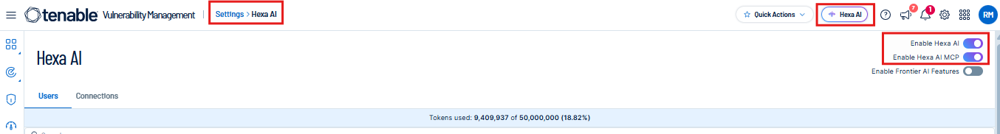

# RBVM Agent — Step-by-step setup

This guide takes you from a clean machine to a first successful run.

Contents: [Part 1 — Outside Claude Desktop](#part-1--outside-claude-desktop) · [Part 2 — Inside Claude Desktop](#part-2--inside-claude-desktop) · [Part 3 — First run and verification](#part-3--first-run-and-verification) · [Troubleshooting](#troubleshooting)

---

## Part 1 — Outside Claude Desktop

### 1.1 Tools

| Tool | Version tested | Check it is installed |
|------|----------------|-----------------------|
| Node.js (provides `npx`) | **Node.js > 20.0 ** | `node --version` and `npx --version` |
| Python | **3.14.6** (the SQLite server pins `mcp==2.3.0`, see `mcp-sqlite/requirements.txt`) | `python --version` (Windows) or `python3 --version` (macOS/Linux) |
| Azure CLI | **2.91.0** | `az --version` |

### 1.2 Tenable

**Which authentication applies?** `mcp-config/mcp-config.json` connects to `https://cloud.tenable.com/mcp/` through `mcp-remote` and authenticates with **API keys** sent in the `X-ApiKeys` header. This is the only authentication the agent uses for the MCP server. Signing in to the Tenable console in a browser is a separate step and is **not** used by the agent.


1. Create the API keys: in Tenable Vulnerability Management, open your user's API keys page (**Settings → My Profile → API Keys**) and generate an access key and a secret key. Store them in a password manager; the secret key is shown only once.
2. Minimum permissions: the user that owns the keys must be able to read vulnerabilities, assets and tags, and to use Hexa AI (Scan Operator, Scan Manager, Standard User or Administrator).
3. Confirm Hexa AI is enabled: sign in to the Tenable console and check that the Hexa AI assistant is available to that user. It will need valid tokens available. If it is missing or you have reached your monthly tokens quota, ask your Tenable administrator to enable it before continuing. 



### 1.3 Tenable tags

The queries in `context/PolicyGV.txt` and the grouping skill depend on these asset tags. Create them in Tenable (**Settings → Tags**) and apply them to your assets before the first run:

| Tag | Used for | Example value |
|-----|----------|---------------|
| `CORE_TEAMS` | Owning team of the asset. Vulnerabilities are grouped per team. Each value must have a matching row in `context/AreaPath.txt`. | `GL_SN_TI_N3_Sales_Platform` |
| `CORE_Ativo-Critico` | Whether the asset is business-critical (Queries 1–3 filter on `CORE_Ativo-Critico: Sim`) | `Sim` |
| `CORE_Internet-Face` | Whether the asset is internet-facing (queries filter on `CORE_Internet-Face: Sim`) | `Sim` |

> Names and Tags' options can be edited according to your scenario or language. 

If a tag is missing, the assets will not match the queries that filter on it, and findings from those queries are not returned. If an asset has no `CORE_TEAMS` value, the findings cannot be assigned to a team or Area Path.

> The README and the grouping skill must use the same tag name. This guide uses `CORE_TEAMS`, as in `skill-policy-based-grouping`. If your tag is named differently, edit `context/PolicyGV.txt` and the skill, not only this guide.

### 1.4 Azure DevOps

1. **Work item type.** In your Azure DevOps organization, create (or inherit from your process) a work item type named **Vulnerability**. Add every custom field the skills read or write:

   | Field | Used by |
   |-------|---------|
   | `V_Assets`, `V_Asset_Priority`, `V_ImpactedBU`, `V_Enviroment`, `V_PCI`, `V_Exposure` | Orchestrator (card content) |
   | `V_TreatmentType`, `V_DetectionOrigin`, `V_Severity`, `V_Emergency` | Orchestrator, dashboard |
   | `V_ReportDate`, `V_DueDate`, `V_Extended_TargetDate` | Orchestrator, dashboard |
   | `V_Tribe1`, `V_ExceptionAnalysis` | Orchestrator, dashboard |

   Note that the field is spelled `V_Enviroment` in the skill; create it with that exact name or change the skill.
2. **States.** The orchestrator uses these states: `Active`, `Resolved`, `Closed`, `Canceled` (see `status-change-criteria.md`). Make sure the Vulnerability type has all four.
3. **Area Paths.** Create every Area Path listed in `context/AreaPath.txt`.
4. **Permissions** for the account used by `az login`: create, update and comment on work items in those Area Paths, plus read access to **Analytics**.
5. **Confirm Analytics (OData) is available.** Open `https://analytics.dev.azure.com/<your-organization>/<your-project>/_odata/v4.0-preview/WorkItems?$top=1` in a browser while signed in. A JSON response means Analytics is available; a 401/403 or an error page means it is disabled or you lack the permission.

> AzureDevOps fields used on this agent represent our daily usage and necessity. Fields on SQLite MCP Server, Orchestrator and Dashboard can be edited according to your organization or usage.

### 1.5 Azure CLI sign-in

The Azure DevOps MCP server is configured with `--authentication azcli`, so it uses whichever account `az` is signed in with.

```
az login
az account show
```

If you have several tenants, sign in to the right one: `az login --tenant <tenant-id>`.
Verify the account can reach your organization:

```
az devops configure --defaults organization=https://dev.azure.com/<your-organization>
az devops project list
```

(The `az devops` commands need the Azure DevOps extension: `az extension add --name azure-devops`.) If the project list prints, the account can reach the organization.

### 1.6 SQLite MCP server

1. Clone or download this repository and choose where it will live. Use the **absolute path to the `mcp-sqlite/` folder** when configuring the SQLite MCP server in the next steps.
2. Create a virtual environment and install the requirements.

   **Windows (PowerShell)**
   ```
   cd <path-to-repo>\mcp-sqlite
   python -m venv venv
   .\venv\Scripts\Activate.ps1
   pip install -r requirements.txt
   ```

   **macOS / Linux**
   ```
   cd <path-to-repo>/mcp-sqlite
   python3 -m venv venv
   source venv/bin/activate
   grep -v -i '^pywin32' requirements.txt > requirements-unix.txt
   pip install -r requirements-unix.txt
   ```
   `pywin32` is Windows-only, so it is dropped on macOS/Linux. `colorama` is harmless there.
3. Choose the database path with the `SQLITE_OUTPUT_DB` variable (for example `C:/TEMP/mcp-sqlite/agent_output.db` on Windows or `~/rbvm/agent_output.db` on macOS/Linux). The folder must exist; the server creates the file and the seven tables (`Query1`–`Query7`) on first start.
4. Optional smoke test: run `python server.py` (with the variable set). It starts silently and waits for MCP messages on stdin; stop it with Ctrl+C. An import or signature error here means the environment is wrong.

### 1.7 Context files

The files in `context/` are **samples**. Replace their contents before the first run:

| File | What to replace | What a valid entry looks like |
|------|-----------------|-------------------------------|
| `PolicyGV.txt` | The seven queries with your Vulnerability Management standard | `Query 1: Emergency P0` followed by the filter text written as in the Tenable query builder |
| `Severity.txt` | The query → emergency-level map | `If ... came from Queries 1, 4, or 5: Consider them Emergency P0.` |
| `SLA.txt` | Your remediation windows | `If the grouping originates from Query 3: Due date: Current Date + 30 calendar days` |
| `Mitigations.txt` | Your compensating controls, by environment | A heading (`On-Premises`, `Web Application`) and one `-Control name` per line |
| `AreaPath.txt` | One row per `CORE_TEAMS` value | `\| GL_SN_TI_N3_Sales_Platform \| Sales & Experience \| Tech\Sales_Platform_Services \| name@yourcompany.com \|` |

Keep the number of queries at seven, because the database has seven tables. Add a row to `AreaPath.txt` whenever a new team appears. If you wish to use less or more queries, edit server.py file so the database can fit to your necessity.

---

## Part 2 — Inside Claude Desktop

### 2.1 Open the MCP configuration file

In Claude Desktop, open **Settings → Developer → Edit Config**. This opens the folder that holds `claude_desktop_config.json`:

- Windows: `%APPDATA%\Claude\claude_desktop_config.json`
- macOS: `~/Library/Application Support/Claude/claude_desktop_config.json`

### 2.2 Merge the three servers without overwriting yours

Do **not** replace the file. If it already has an `mcpServers` object, add the three entries from `mcp-config/mcp-config.json` (`tenable`, `sqlite-output`, `ado`) inside it, next to your existing servers. If a server with the same name already exists, rename ours (for example `tenable-rbvm`) rather than overwriting it. The file must stay valid JSON (commas between entries). Back the file up before editing.

### 2.3 Replace the placeholders

| Placeholder | Replace with |
|-------------|--------------|
| `<your-access-key>` and `<your-secret-key>` | The Tenable API keys from step 1.2. Never commit them. |
| `C:/<your-path>/venv/Scripts/python.exe` | The full path to the Python in your virtual environment (macOS/Linux: `<path>/venv/bin/python`) |
| `C:/<your-path>/mcp-sqlite/server.py` | The full path to `mcp-sqlite/server.py` |
| `SQLITE_OUTPUT_DB` value | The database path from step 1.6 |
| `<your-organization>` | Your Azure DevOps organization name |

**Restart Claude Desktop completely** (quit from the tray or menu bar, then reopen). The file is read only at startup.

### 2.4 Confirm the three servers are connected

Open **Settings → Developer**. `tenable`, `sqlite-output` and `ado` should each show as **running**. Then, in a new chat, open the tools menu and check that tools are listed for each one. The SQLite server must list `create_entry`, `update_entry`, `list_entries` and `read_entry`. If a server shows an error, see [Troubleshooting](#troubleshooting).

### 2.5 Create the RBVM Agent project

1. Create a new project named **RBVM Agent**.
2. Add the five files from `context/` to the project knowledge.
3. Add any project instructions you use. If none, say "No project instructions are needed."

### 2.6 Upload and enable the four skills

Each skill folder has a `.zip` of the same skill. Upload each one in **Settings → Skills** (the menu name can differ between app versions) and switch it on. Name shown after upload comes from the `name:` field of its `SKILL.md`:

| Zip | Name shown in Claude |
|-----|----------------------|
| `skill-policy-based-grouping/vm-policy-based-vulnerability-grouping.zip` | `vm-policy-based-vulnerability-grouping` |
| `skill-save-data-on-sqlite3-database/vm-save-data-on-sqlite3-database.zip` | `vm-save-data-on-sqlite3-database` |
| `skill-azuredevops-vulnerability-orchestrator/vm-azuredevops-vulnerability-orchestrator.zip` | `vm-azuredevops-vulnerability-orchestrator` |
| `skill-generate-html-dashboard/vm-vulnerability-analytics-dashboard.zip` | `vm-vulnerability-analytics-dashboard` |

---

## Part 3 — First run and verification

**Do the first run against a test Azure DevOps project, not production.** The orchestrator creates, reactivates and closes real work items.

| Step | Prompt (inside the RBVM Agent project) | A successful result looks like |
|------|----------------------------------------|--------------------------------|
| 1 | *Run [VM] policy-based grouping* | Claude queries Tenable through Hexa AI and returns a markdown table with one row per future card |
| 2 | *Save the grouping to the database* | Claude calls `create_entry` for each row and reports the created `EntryId`s |
| 3 | *Sync the database with Azure DevOps* | Claude creates one *Vulnerability* work item per row and writes `AzureID` and `StatusCardAzure` back to the database |
| 4 | *Build the vulnerability dashboard* | Claude produces a downloadable HTML dashboard |

**Check the results**

- Database: the file at `SQLITE_OUTPUT_DB` exists and has rows. Ask Claude to run `list_entries` on `Query1` (or open the file in a SQLite viewer). New rows have `AzureID` empty until step 3.
- Azure DevOps: open the test project, **Boards → Work Items**, filter by type *Vulnerability*. A card for each row should exist, in the Area Path from `AreaPath.txt`.

## Troubleshooting

| Symptom | Likely cause and fix |
|---------|----------------------|
| An MCP server does not connect | The JSON is invalid, a path is wrong, or Claude Desktop was not fully restarted. Validate the JSON, check each path exists, restart. For `sqlite-output`, run `python server.py` from the virtual environment to see the error. |
| `tenable` fails to start or returns 401 | API keys wrong or expired; header format must be `X-ApiKeys: accessKey=...;secretKey=...`. |
| `ado` returns no data or 401/403 | `az` is signed out or in the wrong tenant: run `az login` and `az account show`. Check the account's Area Path and Analytics permissions. |
| Card creation fails on a field | A `V_*` custom field is missing from the *Vulnerability* work item type, or a value is not in its picklist. Compare against the table in step 1.4. |
| Hexa AI returns an empty result | The queries match no assets: check the tags in step 1.3 and the query text in `PolicyGV.txt`; confirm Hexa AI is enabled for the API-key user. |
| `create_entry` fails | See `mcp-sqlite/README.md`; confirm the table name is `Query1`–`Query7` (capital Q). |
